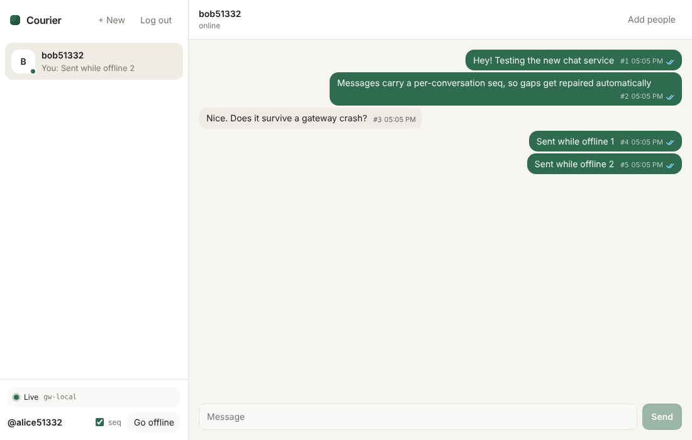
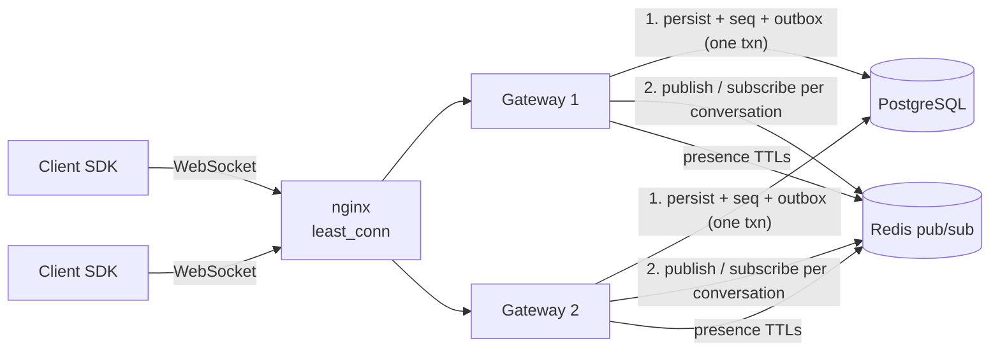

# Courier

A horizontally scalable real-time chat service with **exactly-once, in-order delivery to the application**, built on top of an at-least-once transport. Gateways can crash, Redis can drop messages, and clients can go offline mid-send: every message still arrives once, in order, with no duplicates. Each of those failure modes has an automated test.



## Try it

**Live demo: https://courier-uqen.onrender.com** (free hosting, so the first load after a quiet spell can take up to a minute while the server wakes).

Open the app and click **Try it now**. You get a guest account with a guide bot and a demo room to talk in.

- **Under the hood** (top right) shows every frame as it is sent and received: sequence numbers, acks, receipts, and gap repairs.
- **Try to break it:**
  - **Drop connection** forces a reconnect.
  - **Go offline** lets you keep typing; queued messages go out on reconnect.
  - **Lose 30% of incoming messages** and **Duplicate incoming messages** inject faults on your side.
- Send the guide **`/burst 40`** with loss turned on: all 40 still arrive once, in order, and the log shows each repair.
- **Open a second user** opens a new tab signed in as someone else, already in a chat with you.

The bots are ordinary users that connect over the same WebSocket protocol with the same client SDK as the browser, so their typing, read receipts and replies all go through the real pipeline.

**Stack:** TypeScript · Node.js 22 · WebSockets (`ws`) · PostgreSQL 16 · Redis 7 · React · Prometheus/Grafana · Docker · GitHub Actions

```
packages/protocol   wire protocol (zod-validated frames, shared types)
packages/server     gateway: WebSocket + REST, persistence, fan-out, presence, metrics
packages/client     client SDK: reconnect, resync, ordering, offline outbox
apps/web            React demo app
loadtest            load + chaos harness (spawns gateways, SIGKILLs one mid-run)
deploy              docker-compose (2 gateways, nginx, Postgres, Redis, Prometheus, Grafana)
```

## Results

Measured on a **2 vCPU / 8 GB VM** running everything at once: both gateways, Postgres, Redis, and all 5,000 simulated clients. Raw output is in `loadtest/results/`.

| Scenario | Concurrent clients | Messages sent | Deliveries | p50 | p95 | p99 | Lost / duplicated / out of order |
|---|---|---|---|---|---|---|---|
| Steady state, 2 gateways | 5,000 | 10,620 (~265/s) | 95,580 | 12 ms | 81 ms | 175 ms | **0 / 0 / 0** |
| SIGKILL one gateway at t=20s | 5,000 | 10,446 | 94,014 | 29 ms | 524 ms | 3.75 s* | **0 / 0 / 0** |

Latency is end to end, from the sender's `send()` call to the recipient's app receiving the message, in rooms of 10.
\* The p99 in the kill run is the 2,500 orphaned clients reconnecting with jittered backoff; every one of them converged within 0.2 s of traffic stopping.

## Architecture



### Send path: persist first, then fan out

1. The client queues the message with a client-generated `clientMsgId` (UUID) and pipelines it to the gateway.
2. In **one transaction**, the gateway:
   - claims the next per-conversation seq with `UPDATE conversations SET last_seq = last_seq + 1 … RETURNING`, with the membership check in the same statement;
   - inserts the message (unique on `(conversation, sender, clientMsgId)`);
   - inserts an **outbox** row.
3. It acks the sender (`sent` with the seq), then publishes to the conversation's Redis channel and deletes the outbox row.
4. Every gateway holding a socket for that conversation writes the frame (serialized once) to those sockets.

### Why nothing gets lost or duplicated

| Failure | What handles it | Test |
|---|---|---|
| Client retries a send (timeout, reconnect) | Unique `(conversation, sender, clientMsgId)`; retries get the original seq back with `duplicate: true` | `deduplicates retries…` |
| Gateway crashes after COMMIT, before publishing | Outbox sweeper on every node re-publishes rows older than 2 s (`FOR UPDATE SKIP LOCKED`) | `publishes from the outbox…` |
| Redis pub/sub drops a message | Seqs are **gapless** (rolled-back txns don't burn numbers), so the client sees the hole, waits 250 ms for reordering, then `sync`s from its cursor | `repairs gaps when pub/sub silently drops…` |
| Gateway's Redis subscriber reconnects | Gateway sends every socket a `cursors` frame; clients resync any conversation that moved | `tells clients to resync after the Redis subscriber reconnects` |
| Recipient's gateway crashes | Client reconnects elsewhere; `ready` carries `lastSeq` per conversation; client syncs from its cursor | `loses nothing when the recipient's node crashes` |
| Sender's gateway crashes mid-burst | Unacked sends stay in the client outbox and are resent in order; the server dedupes | `loses nothing (and creates no duplicates) when the sender's node crashes` |
| Messages arrive out of order (two nodes publishing) | Client `Sequencer` buffers and releases strictly by seq | property test over random shuffles with duplicates |
| Race between subscribing and reading cursors | Gateway subscribes **before** reading `lastSeq`, so every message is either live or covered by sync | covered by every reconnect test |
| Deploy / scale-down | `SIGTERM` → drain: refuse new sockets, `going_away` with a jittered reconnect time per client, flush outbox | `drains a node gracefully` |

### Per-sender ordering

A user's messages are stored in the order they called `send()`:

- The SDK pipelines a window of at most 32 sends.
- The gateway processes each socket's sends **serially**.
- Over the rate limit, the gateway **delays** sends (backpressure) instead of rejecting them. A rejection would force a retry that could land behind later messages.
- If a store fails, the gateway is **fail-stop**: it closes the socket so nothing after the failure is stored, and the client resends its queue in order.

## Features

- **Delivery:** exactly-once, in-order delivery per conversation; offline outbox persisted to `localStorage` so it survives reloads.
- **Receipts:** sent, delivered and read, stored as per-user cursors rather than per-message rows. They sync across a user's devices and only ever move forward.
- **Presence:** multi-device. Redis sorted sets with heartbeat-refreshed TTLs, so a crashed node's sessions expire on their own. Deduplicated per socket.
- **Typing indicators:** throttled on both client and server, never stored.
- **Membership:** live join. A newly created or joined conversation is subscribed without reconnecting, and history is backfilled.
- **History:** scrollback over REST (`before` paging); forward catch-up over the socket (`sync`).

### Security

- Short-lived HS256 JWTs (issuer/audience checked). Sockets close when the token expires; the SDK reconnects with a fresh token.
- First-frame auth with a 5 s timeout, so tokens never appear in URLs or logs.
- Origin allowlist on upgrade, which blocks cross-site WebSocket hijacking.
- **Authorization in the database** on every send, sync and history read, not only at login.
- zod validation of every frame:
  - 16 KB frame cap and 4,000-character body cap;
  - control characters stripped and NFC normalization;
  - parameterized SQL throughout.
- Rate limits:
  - per-socket frame rate (flooders are disconnected);
  - send backpressure;
  - bounded send queue;
  - slow-consumer disconnect at 1 MB of unsent data.

### Operations

- Prometheus metrics: connections, sends by outcome, persist latency, fan-out lag, gap repairs, disconnects by reason, outbox re-publishes, bus reconnects, rate limiting, and event-loop lag. A Grafana dashboard is provisioned.
- `/healthz`, plus `/readyz` (returns 503 while draining, so the LB stops routing).
- Structured JSON logs (pino) tagged with node id.

## Running it

**Everything in Docker:**

```bash
docker compose -f deploy/docker-compose.yml up --build
# app http://localhost:8000 · grafana http://localhost:3000 · prometheus http://localhost:9090
```

**Render (free tier):** `render.yaml` defines one web service that runs the gateway and serves the web app, plus free Postgres and Key Value (Redis-compatible). In Render choose **New → Blueprint** and pick this repo. Migrations run on boot. Free web services sleep when idle, so the first visit after a while takes up to a minute to wake; the client reconnects on its own once the service is up.

**Local development** (needs Postgres 16 and Redis 7 running):

```bash
npm install
createdb chat && createdb chat_test
npm run dev                      # gateway on :8080 (runs migrations on boot)
npm run dev -w @courier/web      # web app on :5173 (proxies /api and /ws)
```

Click **Try it now**, or use **Open a second user** to chat between two tabs. Set `DEMO_BOTS=true` to run the guide and demo-room bots.

**Tests and load test:**

```bash
npm test             # 43 tests: protocol, messaging, resilience/chaos, demo bots, sequencer property tests
npm run typecheck
npm run build -w @courier/server
npm run loadtest -- --users 5000 --room-size 10 --rate 300 --duration 40 --spawn 2 --kill-at 20
```

The load test exits non-zero if any client ends up with a missing, duplicated or out-of-order message. CI runs a 1,000-user version with a gateway kill on every push.

### Configuration (env)

| Variable | Default | |
|---|---|---|
| `DATABASE_URL` / `REDIS_URL` | local | |
| `JWT_SECRET` | dev value (required in production, ≥32 chars) | |
| `ALLOW_DEV_LOGIN` | `true` in dev, `false` in production | username-only demo login |
| `ALLOWED_ORIGINS` | any | comma-separated browser origins; `self` allows the gateway's own host |
| `SEND_RATE_PER_SEC` / `SEND_BURST` | 10 / 30 | per-socket send budget (excess is delayed) |
| `FRAME_RATE_PER_SEC` / `FRAME_BURST` | 50 / 200 | per-socket frame budget (excess disconnects) |
| `HEARTBEAT_MS` | 25000 | ping interval; presence TTL is 3× this |
| `MAX_BUFFERED_BYTES` | 1 MiB | slow-consumer threshold |
| `DRAIN_WINDOW_MS` | 10000 | how long reconnects are spread over on shutdown |
| `STATIC_DIR` | unset | serve the built web app from this directory (single-service deploys) |
| `DEMO_BOTS` | `false` | run the guide and demo-room bots on this gateway (one gateway only) |

## Using the SDK

```ts
import { ChatClient, localStorageStorage } from "@courier/client";

const client = new ChatClient({
  url: "wss://chat.example.com/ws",
  getToken: () => auth.freshToken(),          // called on every (re)connect
  storage: localStorageStorage(`chat.${userId}`),
});
client.on("message", (m) => render(m));       // exactly once, in seq order
client.on("receipt", (r) => updateTicks(r));
client.on("status", (s) => showConnection(s));
client.connect();

const id = client.send(conversationId, "hello"); // queued; retried until acked
client.markRead(conversationId);
```

## Protocol

Every frame is JSON with a `t` field (see `packages/protocol`).

| Direction | Frame | Meaning |
|---|---|---|
| client → server | `auth` | token, deviceId, protocol version |
| client → server | `send` | conversationId, clientMsgId, body |
| client → server | `sync` | messages after a seq, paged |
| client → server | `ack` | delivered/read up to a seq |
| client → server | `typing`, `ping` | |
| server → client | `ready` | userId, nodeId, per-conversation `lastSeq` / `readSeq` |
| server → client | `sent` | ack with seq, `duplicate` flag |
| server → client | `message` | a stored message |
| server → client | `sync_result` | page of messages, `hasMore` |
| server → client | `receipt`, `typing`, `presence`, `joined` | |
| server → client | `cursors` | resync hint after a bus outage |
| server → client | `going_away` | reconnect in N ms (drain) |
| server → client | `error` | code, `retryable` |

## Design decisions and trade-offs

- **Postgres row lock for seq assignment.** It is simple and gives gapless numbers. It also serializes writes within one conversation, which caps a single conversation at roughly a few hundred to a few thousand msg/s depending on commit latency. Conversations still scale independently. A busier design would batch-assign seqs or move to a log (Kafka/JetStream) partitioned by conversation.
- **Redis pub/sub as the fast path only.** It is cheap and low-latency, and dropped messages are already handled by seq gaps and the outbox. Sharded pub/sub (`SPUBLISH`) on Redis Cluster is the next step when one Redis is the bottleneck.
- **Per-conversation channels.** A node subscribes only to conversations its users are in. This avoids every node receiving every message, and avoids N publishes per message, which per-user channels would cost.
- **Hash-partitioned messages table (8 partitions).** All reads hit `(conversation_id, seq)`, so partitions keep indexes small and make archiving or moving partitions easy later.
- **JSON over WebSocket.** It is debuggable and fast enough at this size. MessagePack or Protobuf would cut bandwidth and parse cost.
- **Dev login.** A username-only endpoint keeps the demo usable. In production you'd put OIDC in front; the gateway only ever sees JWTs.

## Known limitations

- Presence for very large groups is published per conversation (deduplicated per socket). Big channels should switch to subscribe-on-view presence.
- No member removal or leave yet. Removal also needs a `member_removed` event and channel release.
- Refresh tokens are simply re-issued access tokens. A real deployment needs a separate, revocable refresh token.
- Failover latency is set by client backoff (max 5 s in the load test). Faster failover would mean a lower first-retry delay for `1006` closes, or advertising peers in `ready`.

## Roadmap

- **Scale**
  - Redis Cluster sharded pub/sub.
  - Kafka or NATS JetStream as the durable log, removing the outbox and enabling replay.
  - ScyllaDB/Cassandra for message storage past a single Postgres primary.
  - Read replicas for history.
  - Fan-out-on-read for channels with 10k+ members.
- **Product**
  - Media via S3 presigned uploads (send only a reference).
  - Edits and deletes as tombstone events that take a new seq.
  - Reactions and threads.
  - Push notifications for offline users (APNs/FCM) from an outbox consumer.
  - Full-text search (Postgres `tsvector` or OpenSearch).
- **Security**
  - End-to-end encryption (Signal double ratchet / MLS for groups); the server then only relays ciphertext.
  - Per-user rate limits in Redis across devices.
  - Abuse and spam scoring.
  - Audit log.
- **Ops**
  - OpenTelemetry traces through send → persist → publish → deliver.
  - Autoscaling on connection count rather than CPU.
  - Kubernetes manifests with a `preStop` drain hook.
  - Multi-region with per-region gateways and a single home region per conversation.
